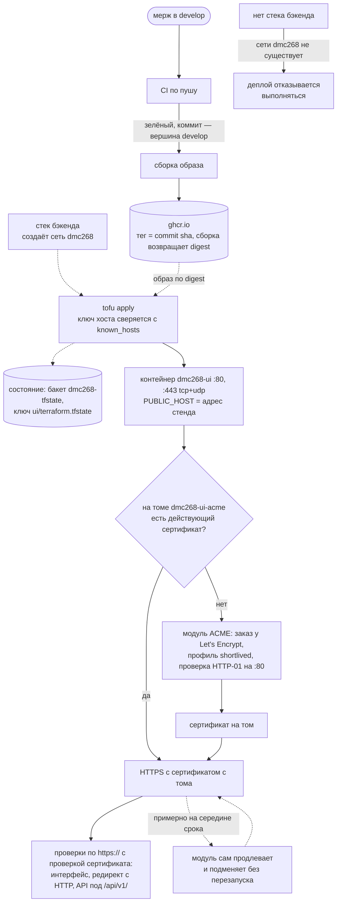
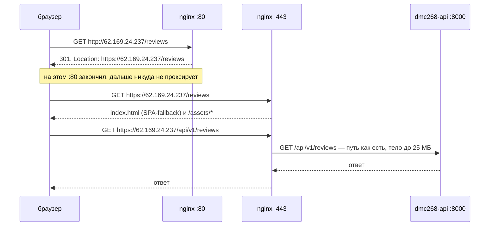
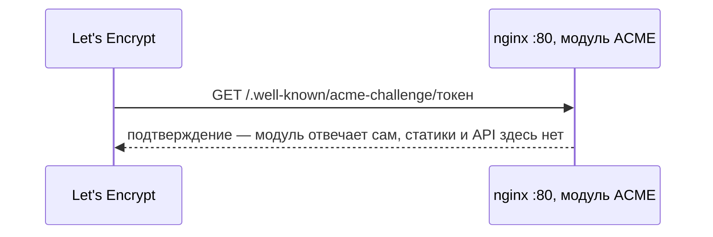

# Деплой UI (nginx + сборка Vite)

Нужны **Docker Engine** на целевом хосте и OpenTofu >= 1.13 (в CI и деплое ставится 1.13.2). Этот стек поднимает только фронтенд.

**Сначала примените `infra/` из `dmc-268-api-t1`.** UI подключается к сети `dmc268`, которую создаёт стек бэкенда, и проксирует `/api/` на контейнер `dmc268-api`. На чистом сервере развёртывание UI откажется выполняться — это требование спеки `frontend-delivery`, а не случайность реализации.

## Деплой

Штатный путь один: **мерж в `develop`**. Дальше всё делает `.github/workflows/deploy.yml` — собирает образ, публикует его в ghcr, открывает туннель к хранилищу состояния, применяет конфигурацию и проверяет по HTTPS, что по адресу отдаётся именно интерфейс, что HTTP перенаправляет на HTTPS и что API через него отвечает.



## HTTPS

Стенд отдаётся по **https://62.169.24.237**. Домена нет, поэтому сертификат выписан прямо на IP: Let's Encrypt выдаёт такие только с профилем `shortlived`, сроком 160 часов. Вручную с ним ничего делать не нужно.

Как браузер попадает к интерфейсу и API:



Отдельно, без участия браузера, — проверка владения адресом при выпуске и продлении сертификата:



Интерфейс и API отдаёт только `:443`. На `:80` браузер получает лишь `301`, а Let's Encrypt — ответ на проверку.

На `:443` по TCP идёт HTTP/2, по UDP — HTTP/3. Браузер всегда приходит по TCP, из заголовка `Alt-Svc` узнаёт про QUIC и следующие запросы шлёт уже по нему. Если UDP по пути закрыт, браузер остаётся на HTTP/2. Поэтому на хосте и у провайдера должен быть открыт и `443/tcp`, и `443/udp`.

TLS снимает сам `nginx` интерфейса встроенным модулем [`ngx_http_acme_module`](https://nginx.org/en/docs/http/ngx_http_acme_module.html) — он уже есть в образе `nginx:1.30-alpine`. Модуль получает сертификат при первом старте, продлевает его до истечения и подменяет без перезапуска. Порт 80 он использует для проверки HTTP-01, остальные запросы на 80 перенаправляются на HTTPS.

Режим выбирает скрипт `nginx/select-site.sh` при старте контейнера по переменной `PUBLIC_HOST`:

| `PUBLIC_HOST`                      | Режим                            | Конфиг                      |
| ---------------------------------- | -------------------------------- | --------------------------- |
| задан (стенд, `public_tls = true`) | HTTPS на этот адрес, 80 → 443    | `nginx/https.conf.template` |
| не задан (локально, CI)            | HTTP на 80, без обращения к ACME | `nginx/http.conf`           |

Общие location — статика, `/api/`, SPA-fallback — лежат в `nginx/site.conf` и подключаются в оба режима.

Ключ ACME-аккаунта и сертификаты лежат на томе `dmc268-ui-acme`. Деплой пересоздаёт контейнер, но не том, поэтому сертификат заново не выпускается. **Не удаляйте этот том без нужды:** у Let's Encrypt лимит — пять одинаковых сертификатов в неделю, и при частых перевыпусках стенд останется без HTTPS до сброса лимита.

Том защищён дважды. У ресурса `docker_volume.acme` стоит `prevent_destroy`: план, который его уничтожает или заменяет, OpenTofu отклоняет сам — и в деплое, и в ручных `tofu apply` и `tofu destroy`. Если блок тома убрать из конфигурации, `prevent_destroy` уйдёт вместе с ним; такой план ловит сторож в `.github/scripts/deploy/plan.sh` — по адресу и по имени тома — и деплой падает до apply. Сменить том можно новым ресурсом, а прежний снять с учёта блоком `removed { from = docker_volume.acme lifecycle { destroy = false } }`: он останется на сервере. Снести стенд целиком `tofu destroy` без снятия `prevent_destroy` нельзя — это намеренно.

Деплой применяет ровно проверенный план (`tofu plan -out`, сторож, `tofu apply tfplan`) и пишет в summary простой публичного входа с разбивкой: остановка старого контейнера, создание нового (со скачиванием образа, если оно пришлось на простой, — так было до #89 / #91, пока образ был отдельным ресурсом), старт и первый ответ HTTPS снаружи. Проверки здоровья у контейнера нет, поэтому готовность и простой берутся снаружи: всё время apply пробник раз в 0,25 с запрашивает `https://<адрес стенда>/`, и простой — от первого отказа до первого ответа 2xx после старта нового контейнера, с точностью до шага пробника. Не дождался пробник ответа — summary берёт первый ответ шага проверки сайта и подписывает простой как верхнюю границу. Если план отклонил `prevent_destroy` тома, summary называет причину, хотя плана в нём нет.

Если сертификат не продлился, а HTTPS отвечает ошибкой, смотрите лог контейнера: `docker logs dmc268-ui 2>&1 | grep -i acme`. Пробовать что-то на стенде лучше против staging Let's Encrypt — `acme_directory = "https://acme-staging-v02.api.letsencrypt.org/directory"`: у него свои, мягкие лимиты, но браузер его сертификату не доверяет.

## Как адресуется API

`nginx` внутри контейнера интерфейса передаёт запросы под `/api/` бэкенду **с исходным путём**:

```
location /api/ {
    proxy_pass $api_upstream;
}
```

Браузерный `GET /api/v1/reviews` приходит на бэкенд как `GET /api/v1/reviews`. Префикс `/api/v1` ставит само приложение — так записано в контракте API (`dmc-268-api-t1`, `docs/openapi/openapi.json`), и прокси его не трогает. Фронтенд обращается к `/api/v1/...` относительными путями, второй адрес ему не нужен.

`/health` через адрес интерфейса не публикуется: это проверка живости для Docker и деплоя бэкенда, она отвечает в корне приложения и ходит мимо `nginx`. Деплой интерфейса проверяет доступность API запросом под `/api/v1/`.

Переменная в `proxy_pass` нужна, чтобы `nginx` стартовал, когда `dmc268-api` ещё не резолвится. URI в `proxy_pass` при этом не указывается: с переменной `nginx` берёт его буквально, и `$api_upstream/` отправил бы любой запрос на `/`. Без URI передаётся исходный путь запроса.

Образ здесь не собирается: он публикуется в `ghcr.io/larchanka-training/dmc-268-ui-t1` с тегом `<commit sha>-<mock|api>` и забирается готовым по digest (`ui_image` — `ghcr.io/…@sha256:…`, деплой передаёт `…:<тег>@sha256:…`): пересборка того же коммита с другими build-args меняет digest, и контейнер пересоздаётся. Ресурса `docker_image` нет: контейнер ссылается на образ строкой `<репозиторий>@sha256:<digest>` (`local.ui_image_ref` в `ui.tf`, тег отброшен — `image` сравнивается строкой, и новый тег при том же digest пересоздавал бы контейнер). Образ скачивает шаг деплоя `docker pull` до apply, поэтому pull из ghcr не попадает в простой между удалением старого контейнера и созданием нового; провайдер сам тянет образ, только если его нет на сервере. Собирать на сервере значило бы отправлять туда исходники и терять кеш слоёв.

Остановка `dmc268-ui` — SIGQUIT и до 10 с ожидания (`destroy_grace_seconds`), без SIGKILL: nginx закрывает соединения сам, открытые потоки SSE обрывает через `worker_shutdown_timeout 1s` (Dockerfile), браузер переподключается к новому контейнеру. Приём новых соединений nginx закрывает сразу по сигналу, поэтому ожидание короткое: это время — отказ на публичном адресе. Первый деплой после перехода на ссылку по digest (#89) пересоздаёт контейнер один раз, даже при том же образе, и ещё с SIGKILL: провайдер удаляет его по прежнему состоянию, где `destroy_grace_seconds` нет.

Переменные, без которых `apply` не пройдёт (в CI приходят через `TF_VAR_*`):

| Переменная                               | Откуда                                                                   |
| ---------------------------------------- | ------------------------------------------------------------------------ |
| `ui_image`                               | ссылка на образ по digest, `…[:тег]@sha256:<64 hex>`; один тег — отказ   |
| `registry_username`, `registry_password` | `github.actor` и `GITHUB_TOKEN`, живут один прогон                       |
| `docker_host`, `service_host`            | `ssh://stand` (хост из `.github/actions/stand-ssh`) и `VPS_DMC268_IP_T1` |
| `bind_ip`, `ui_port`                     | `0.0.0.0` и `80`: на 80 идёт проверка HTTP-01 и перенаправление на HTTPS |
| `public_tls`                             | `true`, стенд отдаётся по HTTPS                                          |

`service_host` и `bind_ip` — разные вещи, и путать их нельзя: первый попадает в адрес для клиента, второй отвечает на вопрос «на каком интерфейсе слушать». `service_host` нельзя ставить в `0.0.0.0` — именно на этом выход `ui_url` раньше и оказывался бесполезным.

`plan` останавливается на проверке переменной, ничего не меняя на сервере, если `ui_image` без digest, `service_host` пуст или равен `0.0.0.0`, или при `public_tls` `ui_port` не 80.

## Хранилище состояния

Состояние лежит в S3-совместимом хранилище на том же сервере (`backend.tf`), в бакете `dmc268-tfstate` под ключом `ui/terraform.tfstate` — отдельно от состояния бэкенда, чтобы применение одного стека не меняло состояние другого.

Состояние блокируется (`use_lockfile`): на время `plan` и `apply` рядом с ним лежит `ui/terraform.tfstate.tflock`, и второй запуск сразу отказывается (с `-lock-timeout` — ждёт). Очередь прогонов деплоя держит `concurrency` в `deploy.yml`, а блокировка закрывает ручной `apply`, идущий мимо неё. Если прогон упал и оставил блокировку, её снимают `tofu force-unlock <ID>` — ID есть в сообщении об ошибке; сначала убедитесь, что другого запуска действительно нет.

Хранилище слушает только петлю сервера, поэтому любая команда, которой нужно состояние, работает через туннель:

```bash
ssh -i <ключ> -o ExitOnForwardFailure=yes -f -N -L 9000:127.0.0.1:9000 <user>@<server>
export AWS_ACCESS_KEY_ID=<логин хранилища> AWS_SECRET_ACCESS_KEY=<пароль> AWS_DEFAULT_REGION=us-east-1
cd infra && tofu init && tofu plan
```

Само хранилище поднимает деплой бэкенда — здесь оно только используется. Ключ и учётные данные лежат в секретах GitHub и наружу не отдаются, так что у большинства их не будет; чтобы разрабатывать, разворачивать стенд не нужно.

Проверить конфигурацию без доступа к состоянию можно всегда — так же её проверяет job `opentofu` в CI:

```bash
cd infra && tofu fmt -check -recursive && tofu init -backend=false && tofu validate && tofu test
```

`tofu test` гоняет `tests/main.tftest.hcl` на mock-провайдере, без Docker и сервера: порты и `PUBLIC_HOST` с TLS и без, подключение к сети `dmc268`, схема `ui_url` и отказы проверок переменных. Отказ на чистом сервере, где нет сети `dmc268`, так не проверить: mock не ищет сеть, а отдаёт заданное имя.

## Раскладка

| Файл                       | Что в нём                                                        |
| -------------------------- | ---------------------------------------------------------------- |
| `versions.tf`              | версии OpenTofu и провайдера, провайдер Docker с доступом к ghcr |
| `backend.tf`               | хранилище состояния и блокировка                                 |
| `variables.tf`             | переменные и их проверки                                         |
| `network.tf`               | сеть `dmc268` стека бэкенда — только поиск, не создание          |
| `ui.tf`                    | том сертификатов и контейнер интерфейса, образ — по digest       |
| `outputs.tf`               | `ui_url`                                                         |
| `tests/main.tftest.hcl`    | `tofu test`                                                      |
| `terraform.tfvars.example` | пример переменных для локального запуска                         |

## Версия провайдера

Точная версия `kreuzwerker/docker` и её хэши закреплены в `.terraform.lock.hcl`, файл коммитится. После смены `version` в `versions.tf` его пересобирают на все платформы команды, иначе `tofu init` на неперечисленной системе допишет в файл свои хэши и оставит изменение в рабочей копии:

```bash
cd infra && tofu init -backend=false -upgrade && tofu providers lock \
  -platform=linux_amd64 -platform=linux_arm64 \
  -platform=darwin_amd64 -platform=darwin_arm64 \
  -platform=windows_amd64
```

Выход: `ui_url`.
